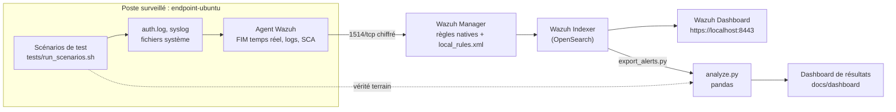

# SOC Homelab : détection mappée MITRE ATT&CK et analyse des alertes avec Wazuh

**Ce projet déploie un mini-SOC, écrit des règles de détection, puis mesure leur efficacité avec des données.** Un SIEM Wazuh 4.14.9 surveille un poste Ubuntu 24.04. Des scénarios inoffensifs reproduisent 10 techniques MITRE ATT&CK. Chaque alerte est rapprochée du scénario qui l'a produite, ce qui permet de calculer le taux de détection, le temps de détection et le bruit, comme dans un vrai SOC.

> Auteur : **Ojewumi Asaph Felix**, Licence 3 Cybersécurité & IA, ESATIC (Abidjan). [Portfolio](https://portfolio-ojewumi.tech/) · [LinkedIn](https://www.linkedin.com/in/asaph-felix-ojewumi-469054324/)

## Résultats

| Indicateur | Natives + mes règles | Natives seules (campagne témoin) |
|---|---|---|
| Techniques détectées (alerte de niveau ≥ 7) | **10/10** | 5/10 |
| Alertes nommées avec la bonne technique MITRE | **10/10** | 2/10 |
| Temps de détection médian | **0,15 s** | 0,1 s (sur les 5 détectées) |
| Faux positifs de mes règles pendant l'activité normale | **0** | – |

Bruit des règles natives : la modification d'un document utilisateur dans `/home` a levé une alerte FIM de niveau 7 pendant l'activité normale de la campagne témoin. C'est une piste d'amélioration documentée dans le [rapport](docs/rapport.md#pistes-damélioration).

Posture du poste mesurée par le module SCA (benchmark CIS Ubuntu 24.04) : **48 %** avant durcissement, **62 %** après ([`hardening/harden.sh`](hardening/harden.sh)).


**[Voir le dashboard interactif](https://asaphfelix03-beep.github.io/soc-homelab/dashboard/)** · [Rapport complet](docs/rapport.md) · [Catalogue des règles et leçons apprises](docs/regles-detection.md)

## Ce que montre ce projet

- **Déploiement d'un SIEM** : Wazuh (manager, indexer OpenSearch, dashboard) en Docker, avec TLS entre composants.
- **Ingénierie de détection** : 11 règles personnalisées, toutes reliées à MITRE ATT&CK, dont 2 règles de **corrélation** (« compte créé puis promu admin », « connexion réussie après une série d'échecs »).
- **Validation rigoureuse** : vérité terrain horodatée, mesure du bruit sur l'activité normale, et **test A/B**. La même campagne est rejouée sans mes règles pour mesurer leur apport réel.
- **Analyse de données** : Python et pandas pour rapprocher les alertes des scénarios et calculer les indicateurs, dashboard Chart.js.
- **Durcissement** : audit CIS automatique, puis correction des écarts applicables.
- **Débogage documenté** : 9 problèmes réels trouvés et corrigés, de la syntaxe des règles à la perte de surveillance FIM après remplacement d'un fichier ([leçons apprises](docs/regles-detection.md#leçons-apprises-problèmes-réels-rencontrés)).

## Architecture



## Scénarios testés

| ID | Technique MITRE | Action reproduite sur le poste | Règle |
|---|---|---|---|
| S01 | T1110.001 Password Guessing | 6 mots de passe sudo erronés puis un succès | 100113 → 100114 |
| S02 | T1136.001 Local Account | Création d'un compte `support_it` | 5902 (native) |
| S03 | T1098 Account Manipulation | Ce compte est ajouté au groupe `sudo` 10 s plus tard | 100110 → 100112 |
| S04 | T1548.003 Sudo and Sudo Caching | Règle `NOPASSWD` dans `/etc/sudoers.d` | 100100 |
| S05 | T1098.004 SSH Authorized Keys | Clé publique ajoutée à `authorized_keys` | 100101 |
| S06 | T1053.003 Cron | Tâche dans `/etc/cron.d` | 100102 |
| S07 | T1543.002 Systemd Service | Service dans `/etc/systemd/system` | 100103 |
| S08 | T1036.005 Match Legitimate Resource Name or Location | Binaire copié dans `/usr/sbin` sous un nom crédible | 100104 |
| S09 | T1021.004 SSH | `PermitRootLogin yes` dans `sshd_config` | 100106 |
| S10 | T1571 Non-Standard Port | Second serveur SSH sur le port 2222 | 100116 |
| B01-B03 | – | Activité normale d'administration (mesure du bruit) | aucune attendue |

Tous les scénarios sont **inoffensifs** : ce sont des actions d'administration exécutées sur le poste du lab, que le script remet ensuite dans son état initial.

## Démarrage rapide

```bash
git clone https://github.com/asaphfelix03-beep/soc-homelab.git && cd soc-homelab
sudo sysctl -w vm.max_map_count=262144
cd lab && docker compose -f generate-indexer-certs.yml run --rm generator
docker compose up -d --build && cd ..
./tests/run_scenarios.sh          # campagne avec règles personnalisées (~15 min)
./tests/run_control.sh            # campagne témoin, règles natives seules (~15 min)
```

Guide détaillé (Windows/WSL 2, export, analyse, dépannage) : [docs/installation.md](docs/installation.md).

## Structure du dépôt

```
lab/                    Docker Compose (Wazuh + poste Ubuntu), configuration de l'agent
detection/rules/        Règles de détection personnalisées (local_rules.xml)
tests/                  Scénarios, scripts de campagne, vérité terrain
analysis/               Export des alertes (API), analyse pandas, données et résultats
hardening/              Script de durcissement CIS
docs/                   Rapport, catalogue des règles, installation, extension Windows, dashboard
```

## Limites

Un seul poste Linux, en conteneur : pas de Windows ([guide d'extension](docs/extension-windows.md)), pas d'attaque réseau réelle, et certains contrôles CIS (partitions, pare-feu, noyau) ne s'appliquent pas à un conteneur. Les scénarios reproduisent des **traces** d'attaque par des actions d'administration ; ils ne remplacent pas un exercice Red Team.

## Licence

Code du projet sous licence MIT. La configuration Docker de base provient de [wazuh/wazuh-docker](https://github.com/wazuh/wazuh-docker) (GPLv2).
