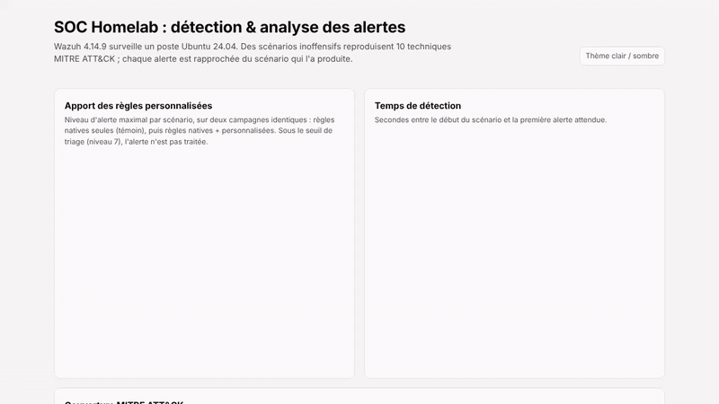
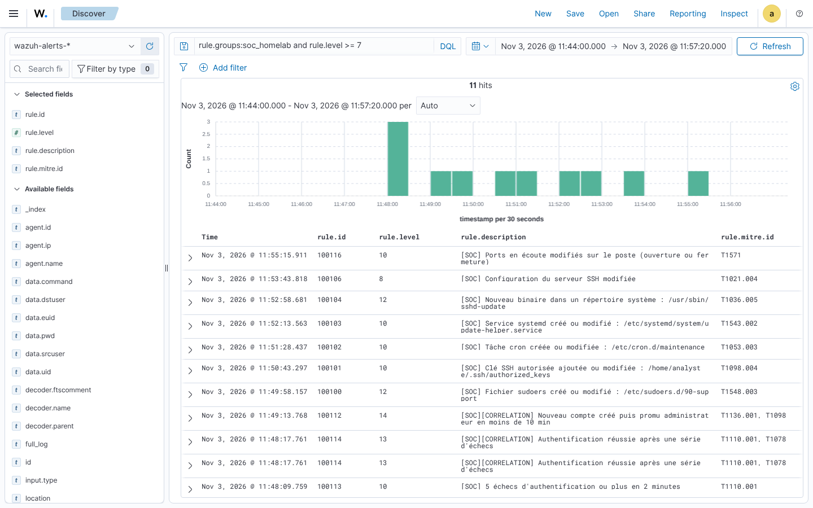
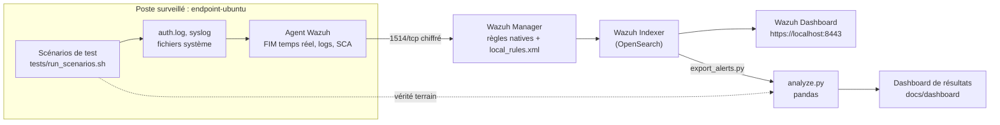

# SOC Homelab : détection mappée MITRE ATT&CK et analyse des alertes avec Wazuh

     

**Ce projet déploie un mini-SOC, écrit des règles de détection, puis mesure leur efficacité avec des données.** Un SIEM Wazuh 4.14.9 surveille un poste Ubuntu 24.04. Des scénarios inoffensifs reproduisent 10 techniques MITRE ATT&CK. Chaque alerte est rapprochée du scénario qui l'a produite, ce qui permet de calculer le taux de détection, le temps de détection et le bruit, comme dans un vrai SOC.

> Auteur : **Ojewumi Asaph Felix**, Licence 3 Cybersécurité & IA, ESATIC (Abidjan). [Portfolio](https://portfolio-ojewumi.tech/) · [LinkedIn](https://www.linkedin.com/in/asaph-felix-ojewumi-469054324/)



**[Dashboard interactif](https://asaphfelix03-beep.github.io/soc-homelab/dashboard/)** · [Rapport complet](docs/rapport.md) · [Règles et leçons apprises](docs/regles-detection.md) · [FAQ technique](docs/faq-technique.md)

## Résultats

Même campagne jouée **avec** et **sans** mes règles (test A/B). La campagne avec règles a été répétée **3 fois**.

| Indicateur | Natives + mes règles | Natives seules (témoin) |
|---|---|---|
| Techniques détectées (alerte de niveau ≥ 7) | **10/10**, à chacune des 3 campagnes | 4/10 |
| Alertes portant la bonne technique MITRE | **10/10** | 2/10 |
| Temps de détection (3 campagnes) | **0,1 s** en médiane (fichiers, temps réel) · S01 seuil de 5 échecs : 17 s à 18 s · S10 ports : 47 s à 60 s | 0,1 s (sur les 4 détectées) |
| Faux positifs pendant l'activité normale (niveau ≥ 7) | **0** sur les 3 campagnes | 1 (document modifié, niveau 7) |

- **Les règles natives voient les événements, mais pas la menace.** Une tâche cron ou une règle sudoers donne « File added to the system » (niveau 5) : sous le seuil de triage et sans technique MITRE. Mes règles nomment la menace, fixent le bon niveau et corrèlent les signaux faibles (« compte créé puis promu admin en moins de 10 min », niveau 14).
- **Moins de bruit.** La modification d'un document dans `/home` levait une alerte native de niveau 7. La règle 100120 la ramène au niveau 3, sans masquer `authorized_keys` ni `.bashrc`.
- **Posture CIS** du poste (module SCA, benchmark Ubuntu 24.04) : **48 %** avant, **62 %** après [`hardening/harden.sh`](hardening/harden.sh).


*Les alertes de mes règles dans l'explorateur de Wazuh : une par technique testée, avec son niveau et sa technique MITRE.*

## Ce que montre ce projet

- **Déploiement d'un SIEM** : Wazuh (manager, indexer OpenSearch, dashboard) en Docker, avec TLS entre composants.
- **Ingénierie de détection** : 12 règles personnalisées (11 de détection reliées à MITRE ATT&CK, dont 2 corrélations, et 1 de réduction du bruit).
- **Validation rigoureuse** : vérité terrain horodatée, test A/B, mesure du bruit sur l'activité normale, 3 campagnes répétées.
- **Analyse de données** : Python et pandas pour rapprocher les alertes des scénarios et calculer les indicateurs, dashboard Chart.js publié sur GitHub Pages.
- **Durcissement** : audit CIS automatique, puis correction des écarts applicables.
- **Débogage documenté** : 11 problèmes réels trouvés et corrigés, de la syntaxe des règles à la perte de surveillance FIM après remplacement d'un fichier ([leçons apprises](docs/regles-detection.md#leçons-apprises-problèmes-réels-rencontrés)).
- **Reproductibilité vérifiée** : lab supprimé puis redéployé depuis un clone neuf du dépôt, avec les mêmes résultats.

## Architecture



## Scénarios testés

| ID | Technique MITRE | Action reproduite sur le poste | Règle |
|---|---|---|---|
| S01 | T1110.001 Password Guessing | 6 mots de passe sudo erronés puis un succès | 100113 → 100114 |
| S02 | T1136.001 Local Account | Création d'un compte `support_it` | 5902 (native) |
| S03 | T1098 Account Manipulation | Ce compte est ajouté au groupe `sudo` 10 s plus tard | 100110 → 100112 |
| S04 | T1548.003 Sudo and Sudo Caching | Règle `NOPASSWD` dans `/etc/sudoers.d` | 100100 |
| S05 | T1098.004 SSH Authorized Keys | Clé publique ajoutée à `authorized_keys` | 100101 |
| S06 | T1053.003 Cron | Tâche dans `/etc/cron.d` | 100102 |
| S07 | T1543.002 Systemd Service | Service dans `/etc/systemd/system` | 100103 |
| S08 | T1036.005 Match Legitimate Resource Name or Location | Binaire copié dans `/usr/sbin` sous un nom crédible | 100104 |
| S09 | T1021.004 SSH | `PermitRootLogin yes` dans `sshd_config` | 100106 |
| S10 | T1571 Non-Standard Port | Second serveur SSH sur le port 2222 | 100116 |
| B01-B04 | – | Activité normale : sudo légitime, faute de frappe, création et modification de documents | aucune au-dessus du seuil |

Tous les scénarios sont **inoffensifs** : ce sont des actions d'administration exécutées sur le poste du lab, que le script remet ensuite dans son état initial.

## Démarrage rapide

```bash
git clone https://github.com/asaphfelix03-beep/soc-homelab.git && cd soc-homelab
sudo sysctl -w vm.max_map_count=262144
cd lab && docker compose -f generate-indexer-certs.yml run --rm generator
docker compose up -d --build && cd ..
./tests/run_scenarios.sh          # campagne avec règles personnalisées (~16 min)
./tests/run_control.sh            # campagne témoin, règles natives seules (~17 min)
```

Guide détaillé (Windows/WSL 2, campagnes répétées, export, analyse, dépannage) : [docs/installation.md](docs/installation.md).

## Structure du dépôt

```
lab/                    Docker Compose (Wazuh + poste Ubuntu), configuration de l'agent
detection/rules/        Règles de détection personnalisées (local_rules.xml)
tests/                  Scénarios, scripts de campagne, vérité terrain
analysis/               Export des alertes (API), analyse pandas, données et résultats
hardening/              Script de durcissement CIS
docs/                   Rapport, règles, FAQ, installation, extension Windows, dashboard
```

## Limites

Un seul poste Linux, en conteneur : pas de Windows ([guide d'extension](docs/extension-windows.md)), pas d'attaque réseau réelle, et certains contrôles CIS (partitions, pare-feu, noyau) ne s'appliquent pas à un conteneur. Les scénarios reproduisent des **traces** d'attaque par des actions d'administration ; ils ne remplacent pas un exercice Red Team.

## English summary

A home SOC lab built on **Wazuh 4.14.9** (manager, OpenSearch indexer, dashboard) monitoring an Ubuntu 24.04 endpoint. Ten MITRE ATT&CK techniques (cron persistence, SSH authorized keys, sudoers abuse, account creation and privilege escalation, systemd services, masquerading, non-standard ports…) are reproduced with safe, repeatable admin actions and timestamped ground truth.

- **12 custom rules**: 11 detection rules mapped to MITRE ATT&CK, including 2 correlation rules, plus 1 noise-reduction rule.
- **A/B test**: the same campaign was run with and without the custom rules. Detection above triage level: **10/10 vs 4/10**. Alerts tagged with the right MITRE technique: **10/10 vs 2/10**.
- **Repeatability**: 3 identical campaigns, 10/10 detected every time, **0 false positives** at triage level, median time to detect **0.1 s**.
- **Hardening**: CIS benchmark score raised from 48 % to 62 %.
- **Data analysis** in Python/pandas and a Chart.js dashboard: [live dashboard](https://asaphfelix03-beep.github.io/soc-homelab/dashboard/).
- **11 real issues** found and documented, for example: Wazuh's real-time FIM loses track of a single watched file once `sed -i` replaces it (new inode). The fix is to monitor the parent directory with `restrict`.

## Licence

Code du projet sous licence MIT. La configuration Docker de base provient de [wazuh/wazuh-docker](https://github.com/wazuh/wazuh-docker) (GPLv2).
