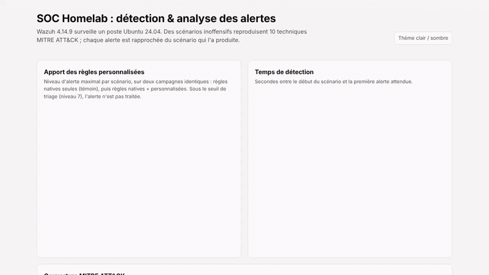
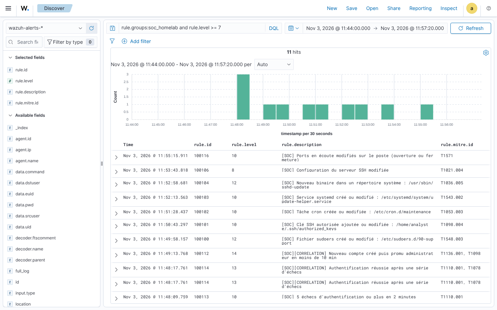

# SOC Homelab : détection mappée MITRE ATT&CK avec Wazuh

Un SIEM Wazuh 4.14.9 surveille un poste Ubuntu 24.04. Dix techniques MITRE ATT&CK sont reproduites par des scénarios inoffensifs, puis chaque alerte est rapprochée du scénario qui l'a produite.

| Indicateur | Natives + mes règles | Natives seules |
|---|---|---|
| Techniques détectées (niveau ≥ 7) | **10/10**, à chacune des 3 campagnes | 4/10 |
| Alertes avec la bonne technique MITRE | **10/10** | 2/10 |
| Faux positifs pendant l'activité normale (niveau ≥ 7) | **0** | 1 |
| Score CIS du poste | 48 % → **62 %** après durcissement | |

## Explorer

- **[Dashboard interactif](dashboard/)** : résultats, temps de détection, couverture MITRE, posture CIS
- [Rapport complet](rapport.md) : méthodologie, test A/B, limites
- [Catalogue des règles et leçons apprises](regles-detection.md)
- [FAQ technique](faq-technique.md)
- [Installer et reproduire le lab](installation.md)
- [Code source sur GitHub](https://github.com/asaphfelix03-beep/soc-homelab)

*Ojewumi Asaph Felix, L3 Cybersécurité & IA, ESATIC (Abidjan). [Portfolio](https://portfolio-ojewumi.tech/) · [LinkedIn](https://www.linkedin.com/in/asaph-felix-ojewumi-469054324/)*
